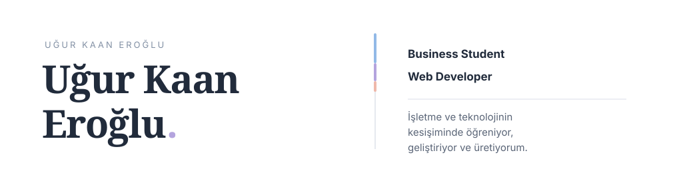

<!-- Editorial Soft / Asymmetric — Uğur Kaan Eroğlu -->

  <picture>
    <source media="(prefers-color-scheme: dark)" srcset="./assets/hero-dark.svg" />
    <source media="(prefers-color-scheme: light)" srcset="./assets/hero-light.svg" />
    
  </picture>

**Merhaba, ben Kaan.**

İşletme eğitiminin yanında web geliştirmeyle ilgileniyorum. Yeni teknolojileri keşfetmeyi, öğrendiklerimi uygulamayı ve fikirlerin nasıl gerçek projelere dönüşebileceğini görmeyi seviyorum.

<picture>
  <source media="(prefers-color-scheme: dark)" srcset="./assets/rule-dark.svg" />
  
</picture>

### 01 / Hakkımda

Dokuz Eylül Üniversitesi İşletme Bölümü öğrencisiyim. Geleneksel işletmecilik ilkelerini dijital çağın sunduğu teknolojiler ve yenilikçi iş modelleriyle bir araya getirmeye ilgi duyuyorum. İşletmelerin mevcut yapılarını koruyarak değişen koşullara uyum sağlamasına katkıda bulunabilecek stratejik ve analitik bir bakış açısı geliştirmeyi hedefliyorum.

<picture>
  <source media="(prefers-color-scheme: dark)" srcset="./assets/rule-dark.svg" />
  
</picture>

### 02 / Odaklandıklarım

Web geliştirme alanında kendimi geliştiriyor, farklı teknolojileri öğrenerek deneyim kazanmaya çalışıyorum.

**Web geliştirme**

<picture>
  <source media="(prefers-color-scheme: dark)" srcset="https://skillicons.dev/icons?i=html,css,js,ts,react,nextjs,tailwind&amp;theme=dark" />
  
</picture>

**Geliştirme araçları**

<picture>
  <source media="(prefers-color-scheme: dark)" srcset="https://skillicons.dev/icons?i=git,github,vscode&amp;theme=dark" />
  
</picture>

<picture>
  <source media="(prefers-color-scheme: dark)" srcset="./assets/rule-dark.svg" />
  
</picture>

### 03 / Bana Ulaşın

Bir fikir paylaşmak, bir proje üzerine konuşmak veya iletişime geçmek istersen bana ulaşabilirsin.

  <a href="mailto:ukaaneroglu@gmail.com">
    <picture>
      <source media="(prefers-color-scheme: dark)" srcset="./assets/email-dark.svg" />
      
    </picture>
  </a>
  &nbsp;
  <a href="https://www.linkedin.com/in/u%C4%9Fur-kaan-ero%C4%9Flu-728176387/">
    <picture>
      <source media="(prefers-color-scheme: dark)" srcset="./assets/linkedin-dark.svg" />
      
    </picture>
  </a>

